# DBDelve for Android

An Android port of [DBDelve](https://github.com/ShayanAbbas1/dbdelve), the
native desktop database client. It keeps DBDelve's rules and is licensed, like
DBDelve, under the GPL v3 ([LICENSE](LICENSE)).

A native Android client for **PostgreSQL, MySQL 5.6.5 or later, and MongoDB**,
built on the same rules as the desktop app: your statement runs exactly as
typed, every statement passes the connection's mode first, and a connection
starts Read-only.

## Download

Get the latest APK from the
[Releases page](https://github.com/Neoterux/dbdelve-android/releases/latest)
and open it on the phone (allow installing from your browser or file manager
when Android asks). It needs a 64-bit ARM phone on Android 12 or later.

What changed in each version is in [CHANGELOG.md](CHANGELOG.md), and in the
app under **What's new**.

The app updates itself, the way Mihon does. It asks GitHub for the latest
release on launch (at most twice a day) and once a day in the background,
sending nothing but the request itself, and shows a notice (and, with the app
closed, a notification) when a newer one is out, with the start of its notes;
**What's new** opens the release's notes in the app (as text: no page loads,
no link is followed). **Download** fetches the APK inside the app, with its
progress in the notice and a notification; the app then checks it (the
SHA-256 GitHub published for it, that it is DBDelve, newer, and signed with
the same key as the installed app) and **Install** hands it to Android's
installer, which asks before replacing anything. The first Download asks for
the notification permission (refusing it only hides the notifications) and
the first Install for permission to install apps from DBDelve. Turn the
checks off under **Check automatically** in the menu. An APK updates the
installed app only when both are signed with the same key.

## Screenshots

Drawn by `ScreensTest` from the app's own screens, connected to a Postgres
(see [Checks](#checks)).

| Connections | SQL editor | Tab switcher | Results |
|---|---|---|---|
| 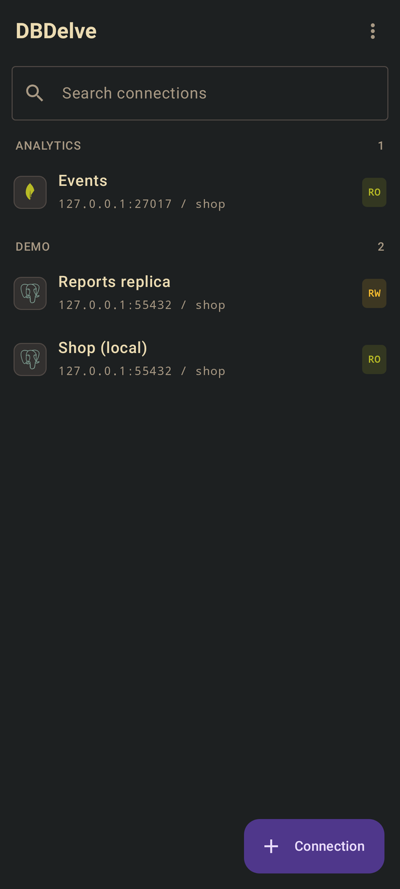 | 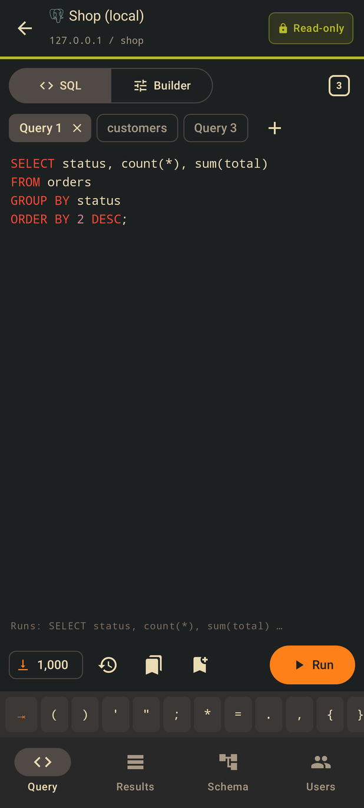 | 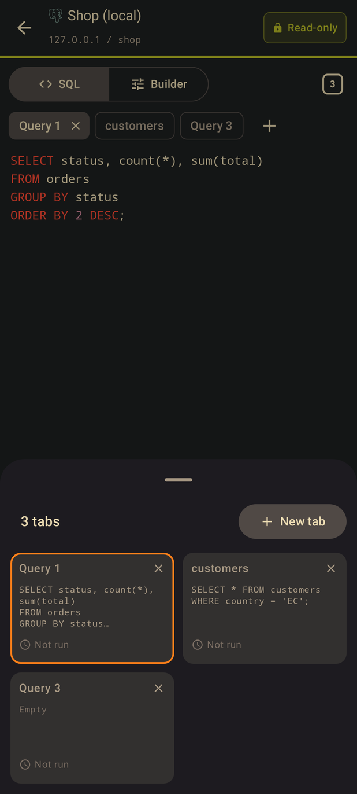 | 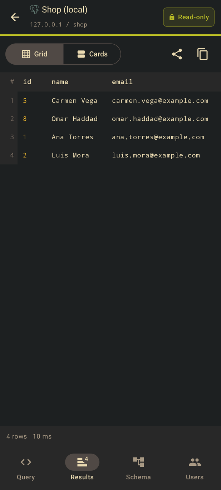 |

| Schema | Query builder | Built query's rows | Built query as SQL |
|---|---|---|---|
| 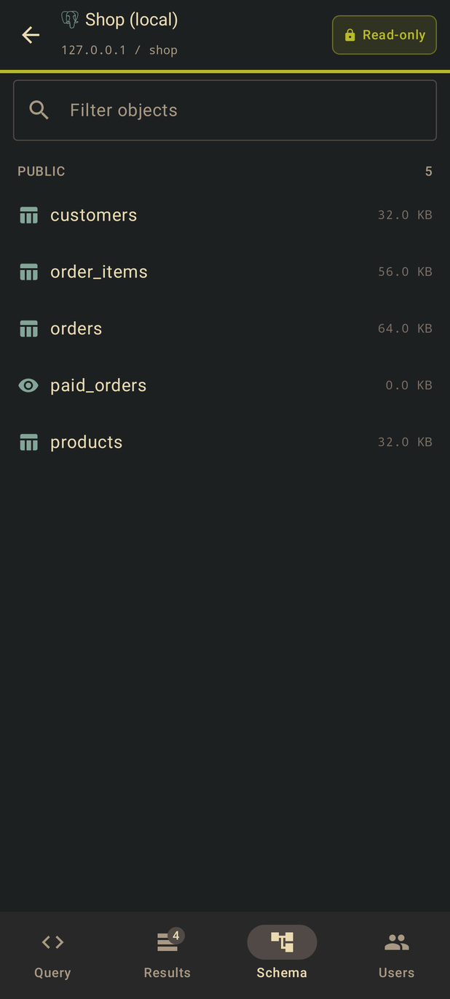 | 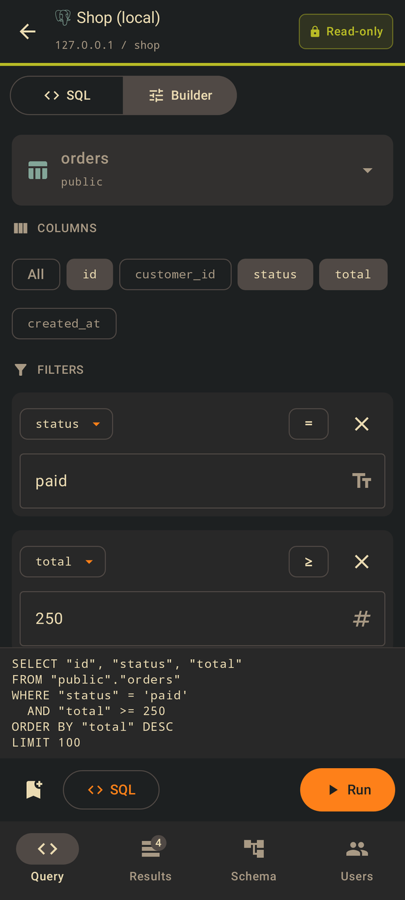 | 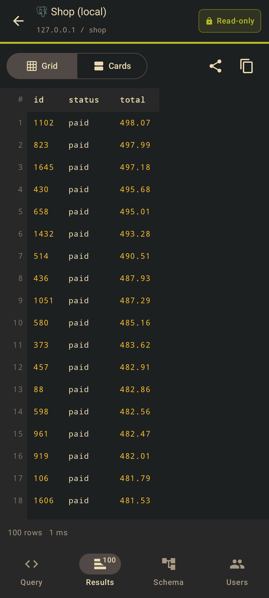 | 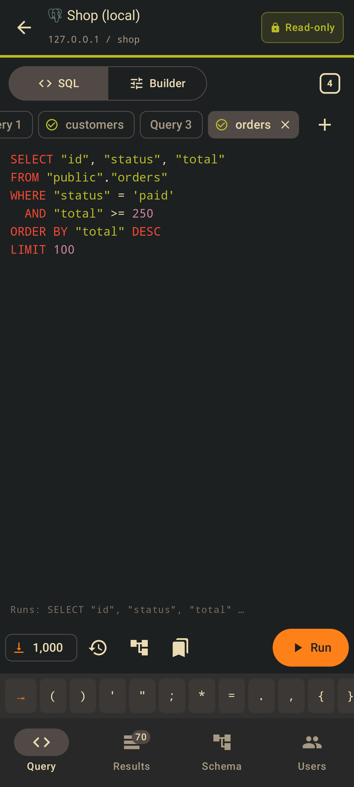 |

| IN and an OR group | Count per group | Counted rows | History |
|---|---|---|---|
| 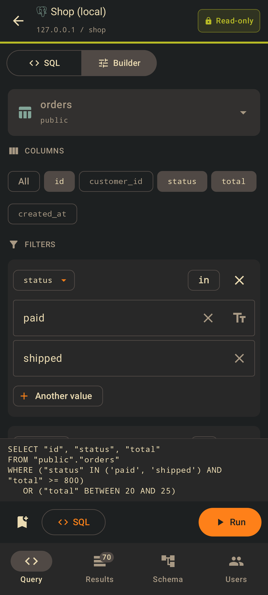 | 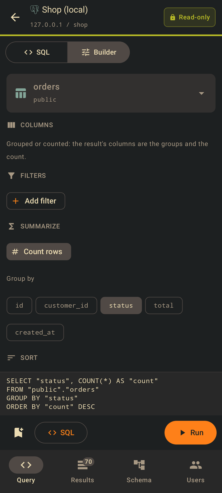 | 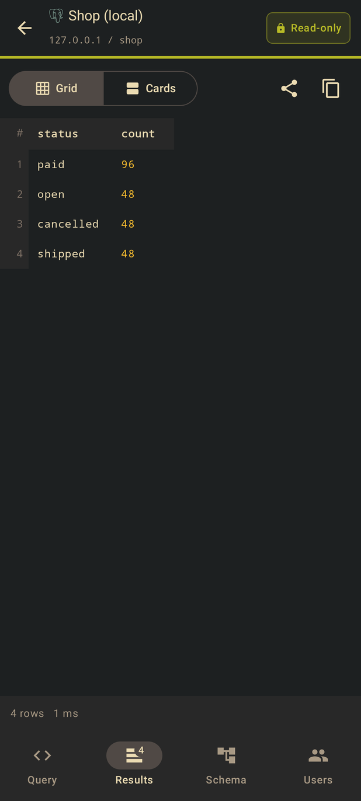 | 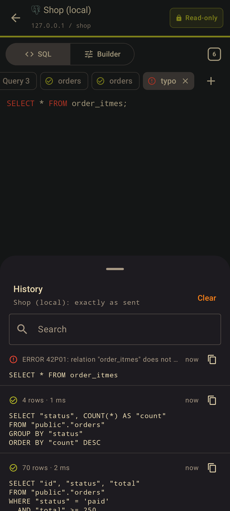 |

| Explain | Completion | A newer release |
|---|---|---|
| 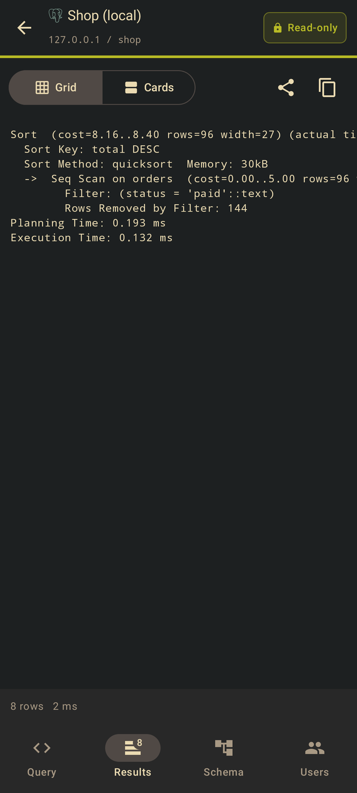 | 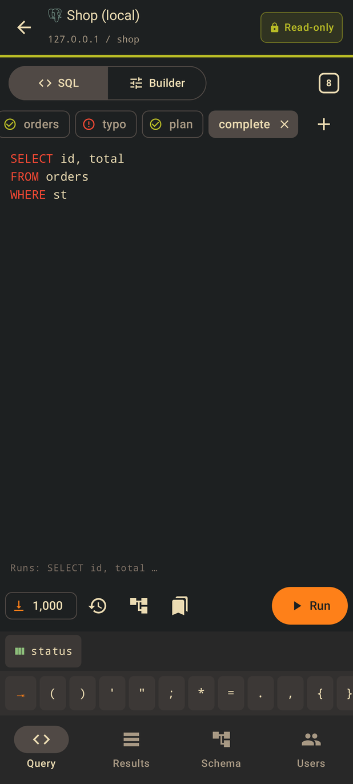 | 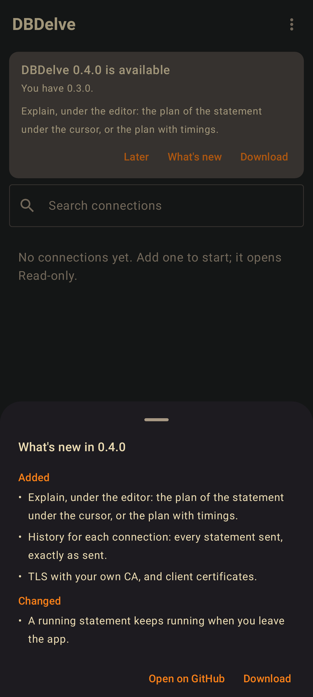 |

| Editing a row | Changed, not yet sent | Review | The gate |
|---|---|---|---|
| 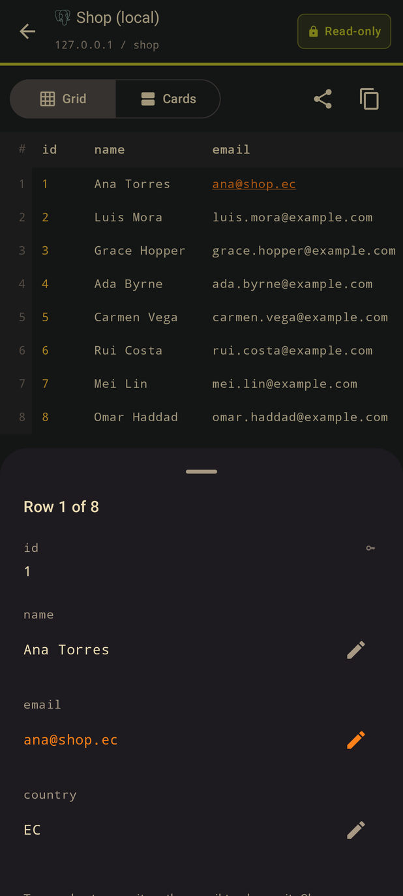 | 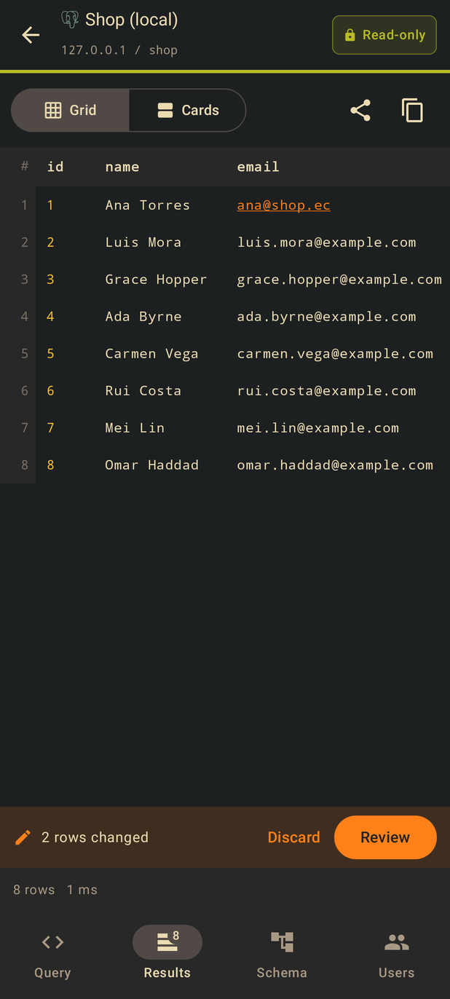 | 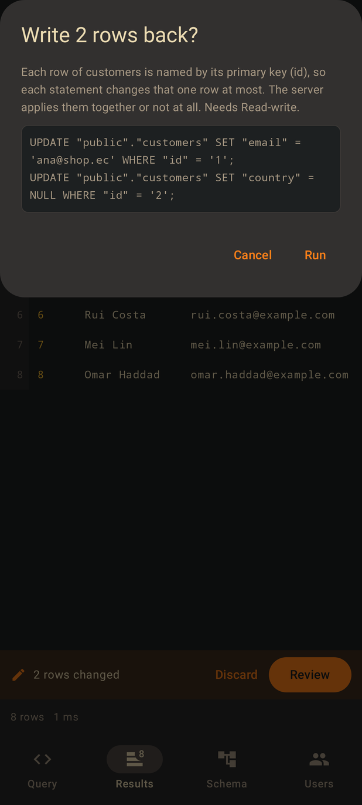 | 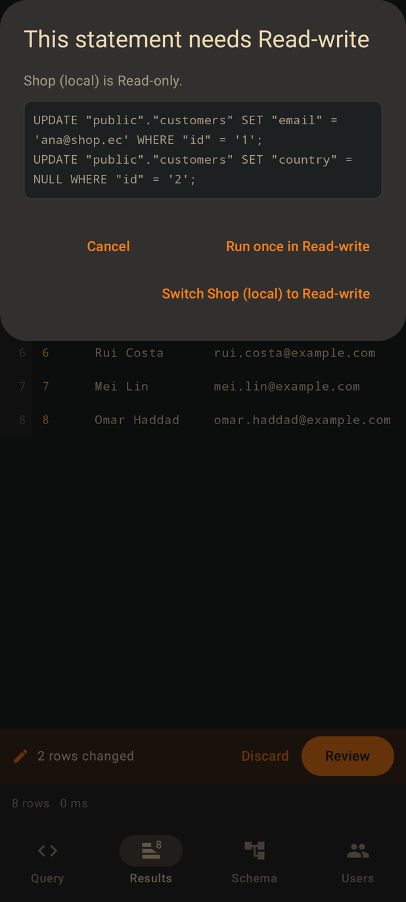 |

## Target

64-bit ARM phones on Android 12 or later.

- **Only `arm64-v8a`, only Android 12 and later (`minSdk 31`, built against
  and targeting 35).** One ABI halves the native build. Android 12 is the
  floor because nothing the app uses needs a version check from there up:
  biometric-or-PIN prompts, the Keystore's AES-GCM, typed foreground services
  and the exception for a refused one all exist on 12. Going lower means
  version checks, and below 11 the keyboard detection the editor relies on
  gets unreliable. On 12 the running-statement notification shows in the
  shade (after ten seconds) and back gestures don't preview. The core is
  linked for API 31 (`cargo ndk -p 31`), and that must stay equal to
  `minSdk`. No x86_64
  emulator image either: test on a phone.
- **No CPU-specific tuning of the Rust core.** It waits on the network, not
  the CPU, and rustls's crypto already detects and uses the chip's AES and SHA
  instructions at runtime.
- **The session belongs to the process, not the screen.** A back gesture,
  swiping DBDelve from recents or Android destroying the activity leaves a
  running statement running; reopening the app finds it, its tabs and its
  results. Once the screen is gone for good, the session closes, at once or
  when the statement running ends.
- **A foreground service while a statement runs** (`QueryService`), because
  some Android builds reclaim background apps within minutes, and that would
  end the process and the session with it. For long statements, also allow
  DBDelve to run in the background in the phone's battery settings.
- **The mode prompt takes face unlock, fingerprint or PIN.** It accepts weak
  biometrics, and many phones' face unlock is not a strong biometric.

## How it is built

```text
core/   Rust: the three drivers, the gate, statement splitting (UniFFI)
app/    Kotlin + Jetpack Compose: the UI, Keystore, the biometric prompt
docs/   mockup.html, the interface design this app follows
```

**Kotlin and Compose for everything you touch, Rust for everything that talks
to a database.** Compose is what the platform's keyboard, accessibility,
biometrics and Keystore are built for. The database side is Rust because:

- It runs the desktop's drivers at the desktop's exact versions
  (`tokio-postgres` 0.7.18, `mysql` 28, `mongodb` 3.9.1) and the same
  `sqlparser` 0.63. A statement is classified on a phone exactly as on desktop.
  A Kotlin rewrite of the gate would be a second gate, and two gates disagree.
- MongoDB doesn't support its Java driver on Android, and MySQL Connector/J
  doesn't target Android. Neither does Rust officially, but these Rust drivers
  are plain Rust, with no JVM classes Android lacks.

The gate in `core/src/gate.rs` is adapted from DBDelve's desktop
`sql::classify` and `sql::gate`. When the desktop's gate changes, port the
change here. `core`'s lockfile was seeded from the desktop's: `mysql` 28.0.0
has since been yanked from crates.io, and only a lockfile that already holds it
can still resolve it. Keep `Cargo.lock` committed.

`Session::run` is the only way a statement reaches a server, and it classifies
and gates before sending. When the gate stops a statement, the app shows the
statement verbatim and calls `run` again with the user's answer. Kotlin
receives rows as strings and type tags, never a driver type.

## Building

Prerequisites: Android SDK 35 and an NDK, Rust with the Android targets, and
`cargo-ndk`.

```sh
rustup target add aarch64-linux-android
cargo install cargo-ndk
export ANDROID_NDK_HOME=$ANDROID_HOME/ndk/<version>
./gradlew :app:assembleDebug        # or open this folder in Android Studio
```

To install on the phone, turn on *Developer options → USB debugging* (tap
*Settings → About phone → Build number* seven times first), connect it, and run
`./gradlew :app:installDebug`, or `adb install app/build/outputs/apk/debug/app-debug.apk`.

`preBuild` runs `cargo ndk` for `arm64-v8a`, then
generates the Kotlin bindings from the built library itself, so they always
describe the core that is packaged.

## Release builds

Release APKs are built by R8: shrunk, optimised and obfuscated, with resources
shrunk, logging removed and nothing debuggable. `app/proguard-rules.pro` keeps
only what R8 cannot see being used: JNA, which reaches the Rust core by
reflection, and the generated bindings it maps by name. The Rust core is built
in release mode, with debug info stripped from the packaged library.

## Installing CI builds

Every push to `main` builds a release APK; open the run under **Actions** and
download the artifact.

**To publish a release** anyone can download: move the changelog's
*Unreleased* entries under a new `## <version> (<date>)` heading and push,
then open **Actions → build → Run workflow** and enter the version (e.g.
`0.2.0`). The run builds the APK, creates the tag `v0.2.0` on that commit and
publishes `dbdelve-android-0.2.0.apk` with that changelog section as its notes.
Pushing a `v*` tag does the same.

**Sign with your own key, once.** Every build except a pull request's
needs it: a push to `main`, a tag or a published release with no key fails
instead of shipping an APK signed with a throwaway key, which Android refuses
to install over the previous one without uninstalling first (and that deletes
saved connections). After the build, CI checks the APK is not signed with a
debug key. Pull requests still build with the runner's debug key, since a
fork's pull request gets no secrets.

```sh
keytool -genkeypair -v -keystore dbdelve-release.jks -alias dbdelve \
  -keyalg RSA -keysize 4096 -validity 10000
base64 -w0 dbdelve-release.jks      # macOS: base64 -i dbdelve-release.jks
```

Then add four repository secrets under *Settings → Secrets and variables →
Actions*: `DBDELVE_SIGNING_KEYSTORE_BASE64` (that base64 output),
`DBDELVE_SIGNING_STORE_PASSWORD`, `DBDELVE_SIGNING_KEY_ALIAS` (`dbdelve`) and
`DBDELVE_SIGNING_KEY_PASSWORD`. Keep the `.jks` file and its passwords
somewhere safe and out of the repository: losing them means no build can
update the installed app again.

## Checks

```sh
cd core
cargo fmt --check
cargo clippy --all-targets -- -D warnings
cargo test                                   # gate, Mongo parser, splitting
cargo test -- --include-ignored              # plus live servers, see below
```

The live tests read `DBDELVE_ANDROID_POSTGRES`, `DBDELVE_ANDROID_MYSQL` and
`DBDELVE_ANDROID_MONGO`, each `host:port:user:password:database`, and skip
any that is unset:

```sh
docker run -d -p 53356:3306 -e MYSQL_ROOT_PASSWORD=pw -e MYSQL_DATABASE=dev mysql:5.6
docker run -d -p 55416:5432 -e POSTGRES_PASSWORD=pw -e POSTGRES_DB=dev postgres:16-alpine
docker run -d -p 57007:27017 mongo:7
DBDELVE_ANDROID_MYSQL=127.0.0.1:53356:root:pw:dev \
DBDELVE_ANDROID_POSTGRES=127.0.0.1:55416:postgres:pw:dev \
DBDELVE_ANDROID_MONGO=127.0.0.1:57007:::dev \
cargo test -- --include-ignored
```

TLS beyond the public roots has its own servers, skipped unless set:
`DBDELVE_ANDROID_TLS_CERTS` names a directory holding `ca.pem`, `client.pem`
and `client.key` (signed by that CA for the user `tlsuser`) and `self.pem`,
and `DBDELVE_ANDROID_POSTGRES_TLS`, `DBDELVE_ANDROID_MYSQL_TLS`,
`DBDELVE_ANDROID_MONGO_TLS` and `DBDELVE_ANDROID_POSTGRES_SELF_SIGNED` name
servers presenting that CA's certificate (or, the last, `self.pem`). CI makes
the certificates and servers in `.github/tls.sh`.

They prove, on each engine, that:

- A user created here with a password hashed on this side can log in, its
  grant shows, its revoke clears it, its drop asks first, and it can no longer
  log in afterwards.
- Read-only refuses a write before sending it.
- The row limit keeps two of three rows and reports that it capped.
- A drop asks for Full and then for confirmation, and a run once leaves the
  mode where it was.
- In Read-only, a write the parser cannot read is refused before it is sent;
  and on Postgres and MySQL the server's own hold still refuses a write
  hidden in a function the gate reads as a plain `SELECT`.
- Cancel stops a 30-second sleep.
- A row edit reads the primary key (in key order, none for a view), is
  stopped in Read-only, runs once in Read-write, and writes exactly the
  values given, NULL included; on MongoDB, by an ObjectId or a string `_id`.
- A private CA's certificate is refused on the public roots and accepted with
  that CA; a self-signed Postgres certificate is accepted as the CA; a user
  the server admits only by certificate is refused without one and admitted
  with it; and no TLS file outlives its session.
- A read past the row limit is stopped, not drained: a twenty-million-row
  Postgres read and a multi-million-row MySQL cross join both come back in
  seconds. Inside a Postgres transaction you opened, the read is drained
  instead, since a cancel would abort the transaction, and it stays usable.

### Screenshots

`ScreensTest` draws the screens under Robolectric, through the core built for
the host, against a live Postgres; it is skipped unless `DBDELVE_SCREENS_PG`
is set. It writes `app/build/screens/`, from which `screenshots/` is copied
at half size.

```sh
psql -h 127.0.0.1 -p 55432 -U dbdelve -c 'CREATE DATABASE shop'   # any database with tables
(cd core && cargo build --release --lib)                          # the host's libdbdelve_core
DBDELVE_SCREENS_PG=127.0.0.1:55432/shop/dbdelve \
  ./gradlew :app:testDebugUnitTest --tests dev.dbdelve.android.ScreensTest
```

The user must log in with a blank password (`trust` authentication).

## MySQL 5.6

- **5.6.5 or later.** That release added `SET SESSION TRANSACTION READ ONLY`,
  which holds a Read-only session on the server. Older servers fail to connect
  with that reason, rather than connecting without the hold.
- **TLS.** The app accepts TLS 1.2 or later only. MySQL 5.6 builds linked
  against yaSSL offer only TLS 1.0 and 1.1, so "Verified" fails and names the
  cause. Either enable TLS 1.2 on the server, or choose TLS "Off" over a
  network you trust (VPN or SSH tunnel). It never falls back to plaintext
  silently. A server with a certificate from your own CA needs that CA under
  [TLS](#tls), not Off.
- No statement timeout is set: `max_execution_time` arrived in 5.7. Cancel
  sends `KILL QUERY` on a side connection.
- Auth is `mysql_native_password`, 5.6's default.
- **Table sizes only for the connection's own database.** The Schema pane
  lists every database's tables by name, which 5.6 answers from each
  table's definition file. A size makes the server open the table instead
  and, with `innodb_stats_on_metadata` on (the default before 5.6.6),
  recompute its statistics; across a whole server that takes long enough
  to hold up everything after it on the session, the Users list included.
  So sizes are read for the database the connection names, and the others
  show names alone.

## TLS

**Verified** (the default) means TLS 1.2 or later, with the server's
certificate checked against a root and the host name, and it never falls back
to plaintext. Under it, a connection can also hold:

- **A trusted CA**: your own or your company's CA certificate, trusted besides
  the public roots, so an internal server needs no public certificate. On
  Postgres, a server's own **self-signed** certificate works here too: it is
  trusted only byte for byte. (OpenSSL marks a self-signed certificate as a
  CA, which the TLS library here refuses as a server's own; MySQL's and
  MongoDB's drivers check it that way and refuse it, so on those, issue the
  server a certificate from a CA of your own.) On MongoDB a CA given here
  replaces the public roots, as its driver does; elsewhere it adds to them.
- **A client certificate** and its unencrypted private key, for servers that
  ask the client to prove who it is (Postgres `cert`, MySQL `REQUIRE X509`,
  MongoDB `x.509`). The key is sealed by the Keystore like a password.

Files are chosen with Android's file picker, and each shows its SHA-256
fingerprint to compare with the server's administrator. Nothing here relaxes
a check: there is no "accept any certificate". MySQL's and MongoDB's drivers
read TLS files only from disk, so while such a session is open its PEMs sit
in the app's private no-backup directory, deleted when it closes. A shared
connections file carries the CA always, and the client certificate and key
only with passwords.

The live tests cover this against a private CA, a self-signed Postgres, and
client certificates (see [Checks](#checks)).

## Connection modes

Every statement is classified before it is sent, and runs only if the
connection's mode allows it: Read-only, Read-write, or Full, which writes
and drops need. Three rules keep the gate honest where parser and server could
read the same text differently:

- **A statement the parser cannot read needs Read-write**, even to run once,
  and asks first. Read-only runs only what the gate has read as a read. The
  server's read-only hold is a backstop, not the boundary: a statement can lift
  it (`BEGIN READ WRITE`), and some writes ignore it (`SELECT … INTO OUTFILE`).
- **Any backslash makes a statement unreadable.** Whether `\'` ends a string is
  a server setting (`standard_conforming_strings`, `NO_BACKSLASH_ESCAPES`) the
  parser cannot see, and read the other way a string can hide a `DROP`. A
  regex such as `'\d+'` therefore asks before it runs.
- **Server-wide settings need Full.** `SET GLOBAL` and `SET @@global.…` reach
  every other session, and a read-only transaction does not stop them.

## The row limit

The limit keeps that many rows of your statement as they arrive, and never
changes the statement. A plain single read past the limit is then stopped,
so a phone doesn't download a table only to throw it away: MySQL ends it
with `KILL QUERY` from a side connection, and Postgres cancels it once a side
connection sees, in `pg_stat_activity`, that this session runs exactly that
statement as a transaction of its own. MongoDB drops the cursor. Anything that
writes, takes a lock or sets a session variable is read to its end.

## MongoDB

Commands use the shell's spelling with JSON5 arguments, one per statement:
`db.orders.find({status: 'open'})`, or `db.getCollection('a.b')…` for names
that aren't identifiers. Supported methods: `find`, `aggregate`,
`countDocuments`, `insertOne`/`insertMany`, `updateOne`/`updateMany`,
`deleteOne`/`deleteMany`, `drop`. Types go in Extended JSON:
`{_id: {$oid: '…'}}`. Options the app does not pass on (`upsert`,
`arrayFilters`, a collation) are refused, never silently dropped: dropping
one would run a different command from the one typed.

MongoDB has no server-side read-only hold, so in Read-only the gate is the only
thing that stops a write. Use a read-only role for anything that matters.

## Query builder

**Builder**, beside **SQL** at the top of the Query screen, makes a query by
tapping: choose a table (or **Build a query** on one in Schema), tap its
columns, add filters (=, ≠, <, ≤, >, ≥, like, like ignoring case, in,
between, is null, not null), a sort and a limit. The statement it writes stays
on screen above **Run** as it changes.

- **And, or.** Filters in one group must all hold; **Or…** starts another
  group, and a row matches if any group does: `(a AND b) OR (c)`.
- **Ignoring case** is `ILIKE` on Postgres, `LOWER(…) LIKE LOWER(…)` on
  MySQL (whose collation may already ignore case, or may not), and a regular
  expression with the `i` option on MongoDB.
- **In** takes as many values as you list; **between** takes a from and a to,
  both included.
- **Count rows**, and **Group by** one or more columns, answer "how many":
  one row per group with its `count`, sortable by either. On MongoDB this is
  a `$group` pipeline; fields named with a `.` or a leading `$` read as paths
  there, so they are not offered to group by.
- **No joins.** They are where tapping gets worse than typing; write those in
  the SQL editor.

On MongoDB the columns to choose from are every field found in a random
sample of 100 documents (`$sample`), so a field most documents lack still
shows.

The core writes the statement (`core/src/builder.rs`), quoting every name in
the engine's own way, and every value typed into a filter becomes a `:name`
parameter that is filled exactly as a saved query's is (below): nothing typed
is spliced into SQL. **Run** and **SQL** both put the filled statement in a
tab of its own, where it can be read and edited, and it passes the gate like
anything typed. The bookmark saves it *with* its parameters, so each run asks
for the values again. A value is text or a number (the icon in its field
switches); on MongoDB, where `"5"` and `5` differ, that choice matters. With
a sort or a limit, a MongoDB query is written as an `aggregate` pipeline,
since this app's MongoDB commands take no cursor chains.

## Saved queries and parameters

Save the tab you are writing (the bookmarks under the editor, then **Save
this query**) and it is kept for that connection; **Saved queries** in the
same menu opens the list. Write `:name` wherever a value
goes:

```sql
SELECT * FROM orders WHERE customer_id = :customer AND created_at > :since
```

Running it asks for each parameter as text, a number or NULL, shows the
statement it becomes, and runs that in a tab of its own. A value goes in as a
literal (a string quoted, a number checked to be one), never as text spliced
into the statement, and the filled statement passes the same gate as anything
typed. A `:name` inside a string, a comment or a Postgres `::cast` is not a
parameter. On MongoDB, `db.orders.find({status: :status})` works the same way.

## Editing rows

Rows can be changed where the app knows which row each one is: the rows of a
query the builder wrote on one table, or of a table's preview from Schema,
when the table has a primary key and every key column is in the rows. (A
count or a grouping names no row, and neither does a typed query: the app
does not guess where its rows came from.) This is the desktop's primary-key
`UPDATE`, review and write gate:

- **Tap a row, then the pencil** beside a field to change it, or set it to
  NULL. The primary key's own columns (marked with a key) are not editable:
  they name the row. Changed cells show in orange until written or
  discarded; nothing is sent yet.
- **Review** shows the exact statements: one
  `UPDATE … SET … WHERE <every key column> = …` per row, values as string
  literals the server converts to the column's type. Postgres applies a
  batch as one transaction; MySQL gets it inside `START TRANSACTION … COMMIT`.
  On MongoDB each row is an `updateOne({_id: …}, {$set: …})` run in order,
  where a value is a string unless marked as a JSON value (`12`, `true`,
  `{"$date": …}`).
- **The write gate.** Before the review shows them, the core parses its own
  statements back and refuses anything but exactly that: an `UPDATE` of that
  table, literal values, a `WHERE` naming the whole primary key and nothing
  else, read by the gate as a plain write (on MongoDB, an `updateOne` of that
  collection by `_id` with only `$set`). Then **Run** goes through the gate
  like a typed `UPDATE`: it needs Read-write, run once or switched, with the
  same biometric prompt.
- After writing, the rows are read again by the same statement, so what is
  on screen is what the server holds. A failure keeps the changes to try
  again, and on MongoDB says which row failed and that the rest were not sent.
- Not edited: a key column, a value with a backslash on SQL engines (see
  [Connection modes](#connection-modes); write that `UPDATE` in the editor),
  MongoDB fields named with a `.` or a leading `$`, views, and tables
  without a primary key.

## Completion

As you type, the names that complete the word at the cursor show above the
key row: the columns of the tables the text names, then tables (or, after
`db.`, collections). After `alias.` it offers that table's columns, reading
`FROM orders o` and `JOIN orders AS o`. A tap replaces the word, quoting a
name the engine would otherwise read differently (`"Orders"` on Postgres,
which folds unquoted names to lower case). Names come from the schema list
and the server's own column list, read once per table per connection, and
not while a statement runs. No keywords and no guesses: only names that
exist.

## Explain

The plan icon under the editor explains the statement under the cursor:
**Plan** shows how the server would run it and runs nothing; **Plan with
timings** (`EXPLAIN ANALYZE`, or MongoDB's `executionStats`) runs it to
measure. It is a copy: the editor's text is never changed, and the plan
shows as the tab's result, a Postgres plan as text rather than cells.

- With timings, the statement runs, so the gate treats it as the statement
  itself: `EXPLAIN ANALYZE DELETE …` needs Full and asks first, as the
  `DELETE` would. A plain plan of a write passes in Read-only on Postgres;
  MySQL's own read-only hold refuses even to plan one there.
- On MongoDB, a `find`, `aggregate` or `countDocuments` is sent with the
  server's `explain` command, and its plan is shown as one row per stage:
  the stage (`COLLSCAN`, `IXSCAN`…), its index, what it returned, the
  documents and keys it examined, its time, and its filter or index bounds,
  with the totals first. `db.c.find(…).explain()` and
  `.explain('executionStats')` also work typed. Writes are not explained.
- `EXPLAIN ANALYZE` on MySQL needs 8.0.18; on 5.6 the server's error says so.

## History

The clock beside the editor's bookmarks lists every statement this
connection sent, newest first: the exact text (a saved query's or the
builder's with its values filled in), when, and what came of it: rows and
time, rows affected, or the error. Tap one to open it in a tab of its own;
the copy button copies it. A statement sent again moves to the top. Only
what the gate let through is here, since a stop sends nothing; nor are the
user-management statements, which carry password hashes. The last 200 are
kept per connection, on the phone only, and **Clear** forgets them.

## Sharing connections

**⋮ → Share connections** seals the chosen connections, with or without their
passwords, into a `.dbdelve` file and hands it to the share sheet: a chat,
mail, a drive, or Files. It is encrypted with AES-256-GCM under a key drawn
from your passphrase (PBKDF2-HMAC-SHA256, 600,000 iterations, a fresh salt per
file), and the whole file is authenticated: a wrong passphrase or one changed
byte fails to open rather than opening as something else. Send the passphrase
another way than the file.

**⋮ → Import connections** opens such a file with Android's file picker. After
the passphrase, every connection in it is shown for review before anything is
saved: change its name, host, port, user, database, project, TLS and mode;
keep its password or not; and where a connection of that name is already
here, keep both, replace it, or skip it. Imported connections start Read-only,
like any new one, whatever mode they had where they came from.

## Users and roles

The **Users** tab lists the server's accounts: Postgres roles, MySQL
`user@host` accounts, or the users of the connected MongoDB database. Tap one to
see what it may do and to change it. From there you can create a user, change
its password, grant or revoke privileges on all tables in a schema or database
or on one table, grant or revoke roles (Postgres, MongoDB), turn login off or
on (Postgres), or drop it.

The same rules as everything else apply:

- **You read the exact statement before it runs.** The core builds it from
  validated parts: names quoted, privileges from a fixed list, nothing typed
  spliced in. It is held where the UI cannot edit it, so the reviewed text is
  the text that runs.
- **Every change needs Full.** It goes through the same gate and the same
  biometric "run once" as a typed statement. Dropping a user is named in the
  review, and Run confirms it.
- **Passwords are hashed on the phone for Postgres and MySQL.** Postgres gets a
  SCRAM-SHA-256 verifier (Postgres 10+), MySQL its `mysql_native_password`
  hash (5.6 and 5.7; 8.0 removed `IDENTIFIED BY PASSWORD`). The server, its
  statement log and the review only ever see the hash. Postgres passwords must
  be printable ASCII, so the hash matches the server's own. **MongoDB hashes
  on the server, so its password crosses the connection: use TLS.** The review
  masks it.
- **Names with a backslash are refused.** Whether a backslash escapes depends
  on server settings the app cannot see.
- **Postgres won't drop a role that still holds privileges.** Revoking on a
  whole schema also revokes the schema's `USAGE` that granting added. If a drop
  is still refused, the server's message says what is left.
- **MySQL 5.6 has no roles and no account locking**, and caps user names at 16
  characters. The form shows the limit.

The typed MongoDB commands `db.getUsers()`, `db.createUser({…})`,
`db.updateUser(name, {pwd})`, `db.grantRolesToUser(…)`,
`db.revokeRolesFromUser(…)` and `db.dropUser(name)` also work in the editor,
classified the same way.

## Not here yet

Deliberate cuts, not oversights; those with a ceiling in the code are marked
`ponytail:` there.

- **Column types on Postgres.** The simple protocol sends every value as text
  and doesn't say its type.
- **SSH tunnels.** Desktop shells out to the system `ssh`, which Android
  doesn't have.
- **Results across restarts.** Query tabs and their text are kept per
  connection; results are not, and nothing runs again on its own.
- **Command palette and the tablet
  layout from the mockup** ([docs/mockup.html](docs/mockup.html)).

## What has and hasn't been compiled

The Rust core is built, linted and tested, including against MySQL 5.6.51,
Postgres 16 and MongoDB 7. The app builds as an R8 release APK
(`./gradlew :app:assembleRelease`), and `ScreensTest` runs its screens on the
JVM against Postgres 16: connecting, the editor and its tabs, results,
schema, and a query built, run and opened as SQL.

Not yet checked on a phone: touch, the keyboard and its key row, the
biometric prompt, the foreground service, and MySQL and MongoDB through the
UI.
